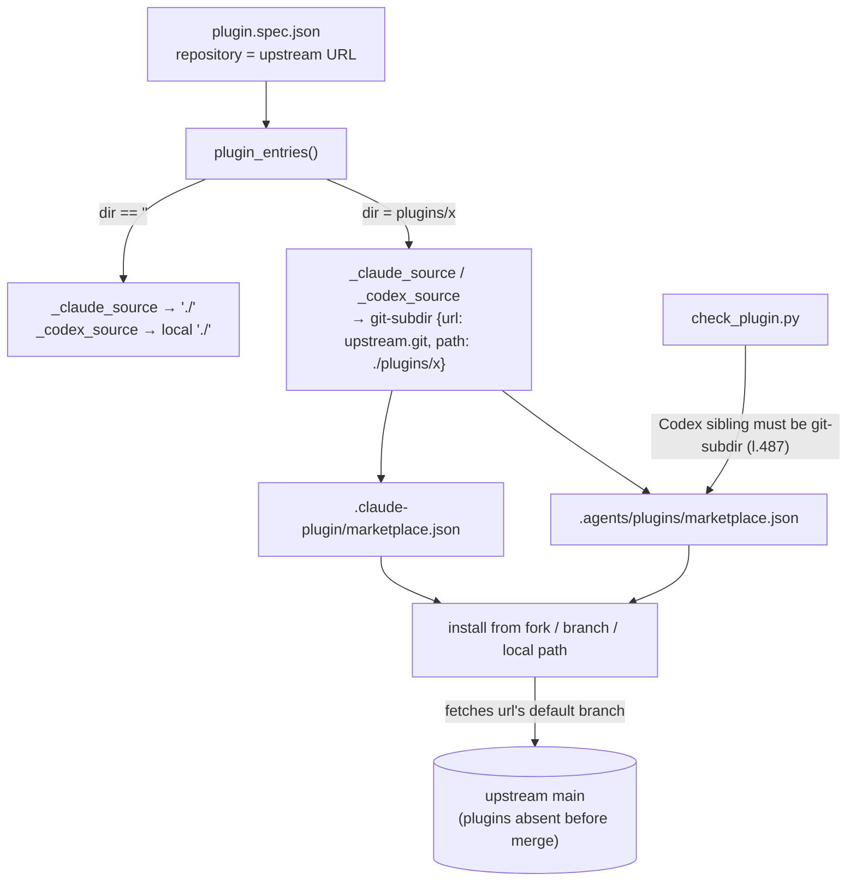
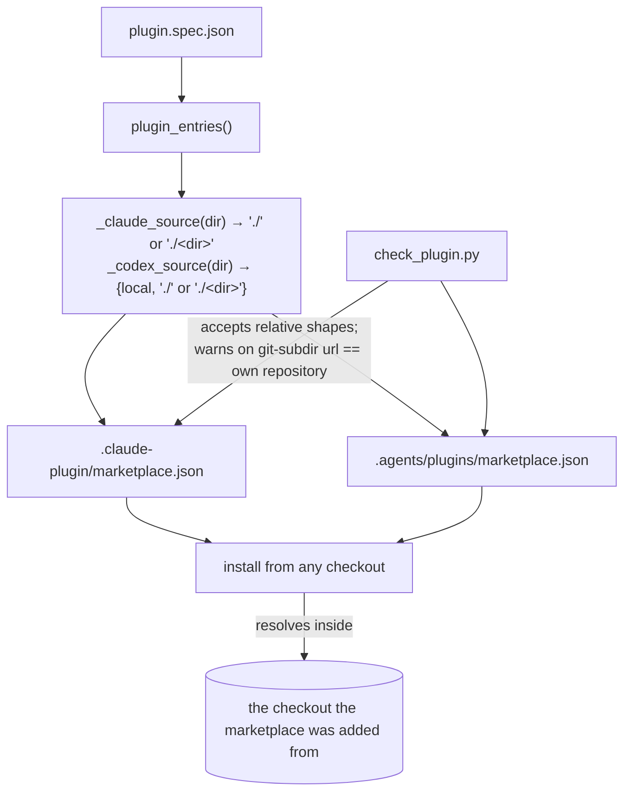
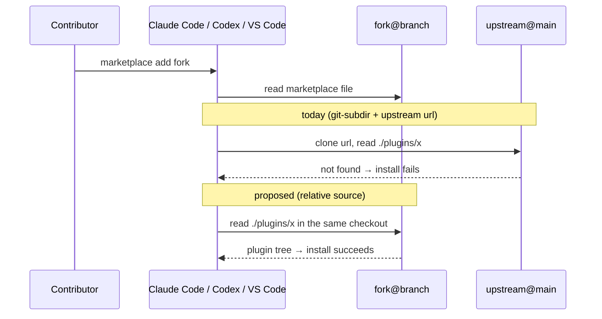

# Marketplace source pinning — Architecture Analysis (v0)

Date: 2026-10-09

Companion to [00-observation_git_subdir_pins_installs_v0.md](00-observation_git_subdir_pins_installs_v0.md)
(the defect and its evidence) and [00-test_definition_marketplace_sources_v0.md](00-test_definition_marketplace_sources_v0.md)
(how to prove the fix).

## Executive Summary

- **Problem:** same-repo marketplaces written by `spawn` point every sibling plugin at
  `git-subdir` + the spec's `repository` URL. That pins installs to the upstream default branch and breaks
  installs from a fork, a branch or a local checkout, which is where a plugin is tested before release.
- **Proposed change:** siblings get sources **relative to the marketplace checkout**: the plain string
  `"./<dir>"` in the Claude marketplace, and `{"source": "local", "path": "./<dir>"}` in the Codex one,
  after a live Codex check (gate G1 below). The checker accepts exactly those shapes, and a new trap entry
  plus a checker warning tell repos spawned with ≤1.0.1 how to repair.
- **Non-goals:** hub-mode catalogues (their entries legitimately name other repositories; the generator
  writes none); `install-snippet` multi-plugin support (a separate, known gap); any downstream repo.
- **Biggest risk:** Codex `local` sources for a subdirectory in a git-added marketplace are unverified.
  If G1 fails, Codex keeps `git-subdir` and the docs say Codex installs track the upstream default branch.
- **Validation:** unit-level assertions on generated sources plus checker behaviour, and one live install
  matrix per host from a fork branch.

## Current State

## Proposed State

## Key Flows

## Contracts & Invariants

**Generator** (`spawn_plugin.py`):

| Function | Today | Proposed |
|---|---|---|
| `_claude_source(dir_, repository)` | `"./"` or `{git-subdir, url, path}` | `"./"` if `dir_ == ""`, else `f"./{dir_}"`. `repository` becomes unused here |
| `_codex_source(dir_, repository)` | `{local, "./"}` or `{git-subdir, url, path}` | `{"source": "local", "path": "./" or f"./{dir_}"}`, **only if G1 passes**; otherwise unchanged |
| `_git_clone_url` | required for every sibling | no longer called for local marketplaces. Keep it only if something still needs a URL (hub tooling) |

**Checker** (`check_plugin.py`):

- Claude entry: `_source_matches(source, "./<dir>")`. A plain string already passes today, and a
  `git-subdir` dict still passes for backward compatibility, but gets the repair warning below.
- Codex entry: `expected_kind` becomes `"local"` for root **and** siblings (if G1 passes), and `git-subdir`
  is accepted with the repair warning.
- New advisory (a note, not a problem, so existing repos don't go red): a local marketplace entry whose
  `git-subdir` `url` (minus `.git`) equals the plugin's own `repository` gets "pins installs to <url>'s
  default branch; use a relative source (traps.md#marketplace-source-pinning)".

**Invariants:**

1. A same-repo marketplace entry never names a URL. Installing from any checkout installs that checkout's tree.
2. Root and sibling plugins use the same source *kind* per ecosystem. Only the path differs.
3. `merge_marketplace` keeps appending only. The fix reaches new entries, and old entries change only by hand (hence the trap and the warning).
4. Hub mode is untouched: `load_spec` / hub suppression logic is not modified.

**Error model:** there is no new hard failure. A spec without `repository` no longer dies for siblings
(`_git_clone_url`'s `_die` path), which is a relaxation, so check nothing else relied on that refusal.

**Docs:** `references/manifests.md` §§ Codex marketplace (l.163) and multi-plugin repositories (l.265)
describe the new shapes. `references/traps.md` gains `#marketplace-source-pinning` (symptom: listed, but
installs fail or install the wrong revision from a fork, branch or local path). `SKILL.md`'s layout block
needs no change.

## Alternatives Considered

| Option | Verdict | Why |
|---|---|---|
| **A. Relative sources in both marketplaces** (proposed) | Chosen, Codex half gated by G1 | Matches root-plugin behaviour; proven for Claude Code and VS Code downstream; MCP_Hackaton converged on it by hand |
| B. Keep `git-subdir`, add `ref` from the current branch | Rejected | Bakes a branch into committed files, so it is wrong after merge and wrong for every other fork |
| C. Spec flag `marketplace.pin: upstream \| relative` | Rejected for now | Nobody has asked for upstream pinning in a same-repo marketplace; a flag doubles the test surface |
| D. Relative for Claude only, keep Codex `git-subdir` | Fallback if G1 fails | Codex installs then track upstream `main`, documented in the trap |

## Risks & Mitigations

| Risk | Likelihood | Mitigation |
|---|---|---|
| Codex rejects `local` + subdirectory path from a git-added marketplace | Medium (unverified) | Gate G1 before changing `_codex_source`; fall back to option D |
| Repos already spawned keep the pinning (merge never rewrites) | Certain | Checker advisory + trap entry with the one-line hand repair |
| `evals/test_regeneration.py` diffs against colgrep-mcp (a root plugin) | Low | Root output is unchanged by construction; run it anyway |
| A downstream release guard asserts the old shape (e.g. mcp-biomodelling-servers' `check_release.py`) | Low; downstream already relative for Claude | Out of scope; mention in the CHANGELOG |
| VS Code behaviour drifts (it defers to Claude's schema) | Low | Covered by the live matrix; VS Code is listed as observed, not guaranteed |

**Gate G1 (do this first):** in a scratch repo with two sibling plugins, write the Codex marketplace by
hand with `{"source": "local", "path": "./plugins/<x>"}`, push to a fork branch, and in Codex add the
marketplace from (a) the fork URL + branch and (b) a local path. Install one plugin each way and confirm
its server starts. Record the result in a `01-findings` report in this topic.

## Roadmap Recommendation

Small enough for one leaf after G1. Make the change in Pinion. It reaches users once Nest points at Pinion
(`rp-04`, `rp-05`, `rp-09`). If it must ship sooner, port the same patch to `cracking-shells-playbook`, whose copy is
identical apart from `.releaserc.js`. Milestones:

1. G1 live check → `01-findings_codex_local_subdir_v0.md`.
2. Generator + checker change, references, trap, CHANGELOG (`fix(spawning-agent-plugins): …`, patch bump).
3. Tests per the test definition; the live install matrix recorded as findings.
